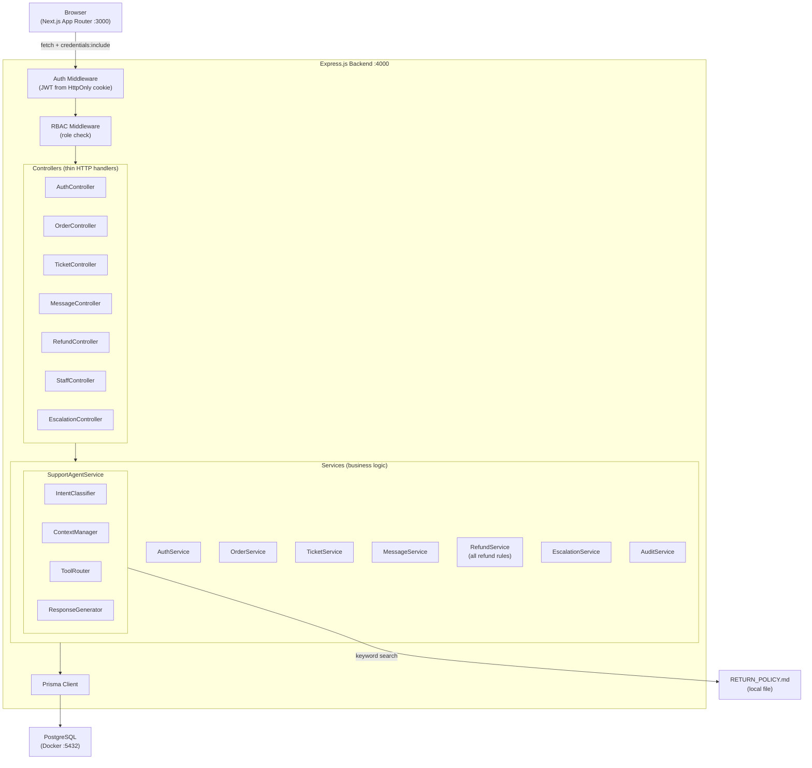

# SYSTEM ARCHITECTURE
> Read by both agents before modifying any cross-module concern.

---

## Overview

The platform is a **modular monolith** comprising:
- A **Next.js** frontend (App Router, TypeScript, CSS Modules) — port 3000
- An **Express.js** backend (TypeScript, Prisma, PostgreSQL) — port 4000
- A **PostgreSQL** database managed via Docker Compose

The frontend and backend are separate processes that communicate exclusively through the documented REST API. The frontend never accesses the database directly.

---

## High-Level Architecture Diagram



---

## Directory Structure

```
support-platform/
│
├── frontend/                    ← Next.js App Router
│   ├── app/
│   │   ├── (auth)/              ← login, register (unauthenticated layout)
│   │   ├── (customer)/          ← dashboard, orders, tickets, chat
│   │   └── (staff)/             ← support dashboard, escalations
│   ├── components/              ← reusable UI components
│   ├── services/                ← API fetch wrappers
│   ├── hooks/                   ← custom React hooks
│   ├── types/                   ← shared TypeScript interfaces
│   └── styles/                  ← CSS Modules / global styles
│
├── backend/
│   ├── src/
│   │   ├── modules/
│   │   │   ├── auth/            ← controller, service, schema
│   │   │   ├── users/
│   │   │   ├── orders/
│   │   │   ├── tickets/
│   │   │   ├── messages/
│   │   │   ├── refunds/
│   │   │   ├── escalations/
│   │   │   ├── agent/           ← SupportAgentService + tools
│   │   │   ├── policies/        ← policy retrieval service
│   │   │   └── audit/
│   │   │
│   │   ├── middleware/
│   │   │   ├── authenticate.ts  ← JWT verification, sets req.user
│   │   │   ├── authorize.ts     ← RBAC role guard
│   │   │   └── errorHandler.ts  ← centralized error handling
│   │   │
│   │   ├── config/
│   │   │   ├── env.ts           ← validated env vars
│   │   │   └── prisma.ts        ← Prisma singleton
│   │   │
│   │   ├── utils/
│   │   │   ├── apiResponse.ts   ← consistent response envelope
│   │   │   └── decimal.ts       ← monetary arithmetic helpers
│   │   │
│   │   ├── app.ts               ← Express app (middleware, routes)
│   │   └── server.ts            ← HTTP server (listen)
│   │
│   ├── prisma/
│   │   ├── schema.prisma
│   │   ├── migrations/
│   │   └── seed.ts
│   │
│   └── tests/
│       ├── auth.test.ts
│       ├── orders.test.ts
│       ├── refunds.test.ts
│       ├── agent.test.ts
│       └── escalations.test.ts
│
├── docs/
│   ├── ARCHITECTURE.md          ← this file
│   ├── DATABASE.md
│   ├── API_CONTRACT.md
│   ├── RETURN_POLICY.md
│   ├── DECISIONS.md
│   ├── SECURITY.md
│   └── TESTING.md
│
├── AI_PROJECT_CONTEXT.md
├── IMPLEMENTATION_PLAN.md
├── HANDOFF.md
├── PROGRESS.md
├── docker-compose.yml
├── .env.example
└── README.md
```

---

## Critical Execution Flows

### Flow 1: Authentication

```
1. Customer submits registration form (POST /api/auth/register)
2. AuthController validates body with Zod schema
3. AuthService checks email uniqueness
4. AuthService hashes password with bcrypt (cost 10)
5. AuthService creates User record in DB (role: CUSTOMER)
6. Response: 201 { success: true, data: { id, email, name, role } }

For login:
1. POST /api/auth/login → Zod validation
2. AuthService finds user by email
3. AuthService compares password with bcrypt.compare
4. AuthService signs JWT { userId, role } with JWT_SECRET, exp: 7d
5. Response sets HttpOnly, SameSite=Lax cookie named 'token'
6. Any protected subsequent request → authenticate middleware reads
   cookie, verifies JWT, attaches req.user = { id, role }
7. RBAC middleware checks req.user.role against allowed roles
```

### Flow 2: Ticket Creation and AI Conversation

```
1. Customer POST /api/tickets → TicketService creates ticket (OPEN)
2. Customer POST /api/tickets/:id/messages with { content }
3. MessageController → MessageService.saveMessage({ senderType: CUSTOMER })
4. MessageController → SupportAgentService.processMessage(ticketId, userId)

Inside SupportAgentService:
5. ContextManager loads: ticket + last N messages + agentContext JSON
6. IntentClassifier.classify(messages) → { intent, entities }
   e.g. { intent: 'REFUND_REQUEST', entities: { orderId: null } }
7. If required entity missing → ResponseGenerator returns clarification question
8. If entities present → ToolRouter.route(intent, entities, userId)
9. ToolRouter calls appropriate tool(s):
   - get_order_details: fetches order (ownership check)
   - search_return_policy: keyword match in RETURN_POLICY.md
   - process_refund: delegates to RefundService
   - escalate_to_human: creates Escalation record
10. ResponseGenerator builds response from tool results
11. MessageService.saveMessage({ senderType: AI, content: response })
12. Response returned to customer
```

### Flow 3: Eligible Refund Processing (≤₹5,000)

```
1. Agent calls process_refund(orderId, amount, reason) with userId from req.user
2. RefundService.processRefund() runs all checks:
   a. Fetch order by orderId WHERE customerId = userId (ownership enforced at DB)
   b. If order not found → 404
   c. Check deliveryDate + RETURN_WINDOW_DAYS >= today → if expired → reject
   d. Validate amount > 0
   e. Compute remaining = order.totalAmount - SUM(previous refunds)
   f. Validate amount <= remaining
   g. If amount <= REFUND_AUTO_APPROVE_LIMIT:
      → Create Refund (PENDING_REVIEW → PROCESSING via transaction)
      → MockPaymentService.execute() → returns simulated success
      → Update Refund status to SUCCEEDED
      → AuditService.log(REFUND_PROCESSED)
3. Return { status: 'SUCCEEDED', refundId }
```

### Flow 4: High-Value Refund Escalation and Human Approval (>₹5,000)

```
1. RefundService.processRefund() runs all checks (same as Flow 3 steps a–f)
2. amount > REFUND_AUTO_APPROVE_LIMIT:
   → Create Refund (status: PENDING_REVIEW)
   → Create Escalation linked to ticketId and refundId
   → Update ticket status to ESCALATED
   → AuditService.log(ESCALATION_CREATED)
   → Return { status: 'PENDING_REVIEW', escalationId }

For human approval:
3. Staff logs in (role: SUPPORT_AGENT)
4. GET /api/staff/escalations → sees escalation with order and customer context
5. Staff reviews and POST /api/staff/escalations/:id/decision { decision: 'APPROVE', note: '...' }
6. EscalationService:
   a. Verifies staff role
   b. Loads escalation + linked refund
   c. Runs final eligibility re-check (amount still valid?)
   d. APPROVE:
      → MockPaymentService.execute(refundId)
      → Update Refund to SUCCEEDED
      → Update Escalation decision = APPROVED
      → AuditService.log(REFUND_APPROVED_BY_STAFF, reviewerId)
   e. REJECT:
      → Update Refund to REJECTED
      → Update Escalation decision = REJECTED
      → AuditService.log(REFUND_REJECTED_BY_STAFF, reviewerId)
7. Customer can query GET /api/refunds/:id to track status
```

---

## Module Responsibility Map

| Module | Files | Responsibility |
|--------|-------|----------------|
| `auth` | controller, service, schema | Register, login, logout, JWT |
| `users` | service | User lookup, profile |
| `orders` | controller, service | Order retrieval with ownership |
| `tickets` | controller, service | Ticket CRUD with ownership |
| `messages` | controller, service | Message persistence, trigger agent |
| `refunds` | controller, service | All refund rules, idempotency |
| `escalations` | controller, service | Escalation queue, decisions |
| `agent` | service, tools | Orchestration, intent, tools, response |
| `policies` | service | RETURN_POLICY.md keyword retrieval |
| `audit` | service | Append-only event log |

---

## Port Map

| Service | Port | Notes |
|---------|------|-------|
| Frontend (Next.js) | 3000 | Dev server |
| Backend (Express) | 4000 | API server |
| PostgreSQL | 5432 | Docker Compose |
