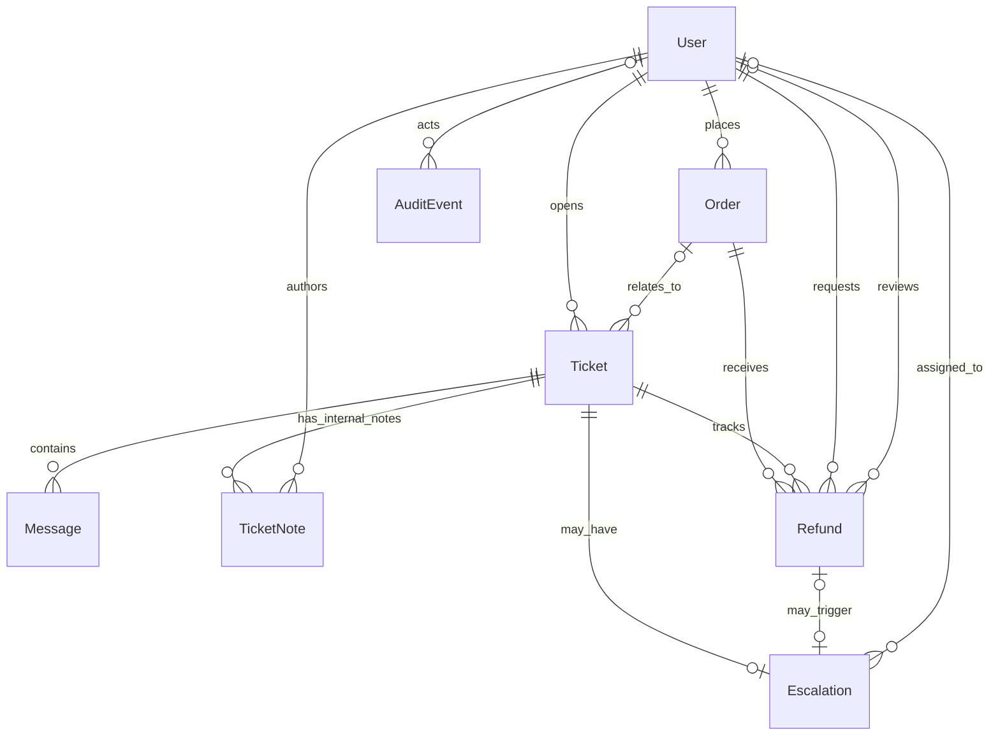

# Database Design

PostgreSQL is accessed through Prisma. Monetary amounts use `Decimal`/`NUMERIC(12,2)`. IDs are opaque CUID strings. All records have a creation timestamp; mutable records also have `updatedAt`.

## Entity relationships



An order belongs to one customer. A ticket belongs to one customer and may reference one order; an order can be associated with multiple tickets. Messages and internal notes belong to a ticket. Refunds reference the order and ticket they concern and the requesting user; a reviewer is optional. A ticket can have at most one escalation. An escalation may be linked to a refund, and assignment to a staff user is optional. Audit events optionally reference an actor because automated/system events may have no user actor; their `entityType` and `entityId` identify any affected record without imposing polymorphic foreign keys.

## Entities

- **User** — name, unique email, password hash, role (`CUSTOMER`, `SUPPORT_AGENT`, `ADMIN`), and timestamps. Password hashes are never returned by API handlers.
- **Order** — customer, unique human-readable order number, status, product name/category, optional delivery date, decimal total. Status: `PENDING`, `PROCESSING`, `SHIPPED`, `DELIVERED`, `CANCELLED`.
- **Ticket** — customer, optional order, subject/description/category, status, priority, optional JSON `agentContext`, and timestamps. Status: `OPEN`, `IN_PROGRESS`, `WAITING_FOR_CUSTOMER`, `ESCALATED`, `RESOLVED`, `CLOSED`; priority: `LOW`, `MEDIUM`, `HIGH`, `URGENT`.
- **Message** — customer-visible conversation content and sender type (`CUSTOMER`, `AI`, `SUPPORT_AGENT`, `SYSTEM`). Internal notes do not belong here.
- **TicketNote** — staff-only note stored separately from messages, with its author and ticket.
- **Refund** — order/ticket, requester, optional reviewer, decimal amount, reason, status and unique idempotency key. Status: `PENDING_REVIEW`, `APPROVED`, `REJECTED`, `PROCESSING`, `SUCCEEDED`, `FAILED`.
- **Escalation** — ticket, optional refund, summary, priority, optional assigned staff member, status (`OPEN`, `UNDER_REVIEW`, `RESOLVED`), decision (`PENDING`, `APPROVED`, `REJECTED`, `REQUEST_INFO`) and timestamps.
- **AuditEvent** — append-only event intent: optional actor, action, entity type/id, optional JSON metadata and creation timestamp. Application code must only insert events; no update/delete service should be introduced.

## Integrity, indexes, and deletion

- Unique constraints: `User.email`, `Order.orderNumber`, `Refund.idempotencyKey`, one escalation per ticket, and one refund association per escalation.
- Foreign keys use restrictive deletion for users/orders/tickets/refunds that anchor financial or audit history. Messages and notes cascade with ticket deletion; order deletion sets optional ticket `orderId` to null. Deleting an assigned user clears the assignment; audit actor deletion clears the optional actor reference.
- Indexes cover customer ownership, order/ticket references, operational statuses and priorities, ticket message chronology, note authorship, escalation assignment, and audit actor/time/entity lookup.
- No soft deletion is used. Ticket status represents closure. Refund and audit history is retained through restrictive relationships.

## Seed data

`backend/prisma/seed.ts` is repeatable: it upserts two customers, one support agent, three orders (including an order outside the return window), three tickets, conversation messages, an internal note, a pending high-value refund, its escalation, and an audit event. All three demo accounts use `DemoPassword123!`; change these credentials outside local development.

Run from `backend/` after starting PostgreSQL and applying migrations:

```sh
npm run db:seed
npm run db:studio
```
