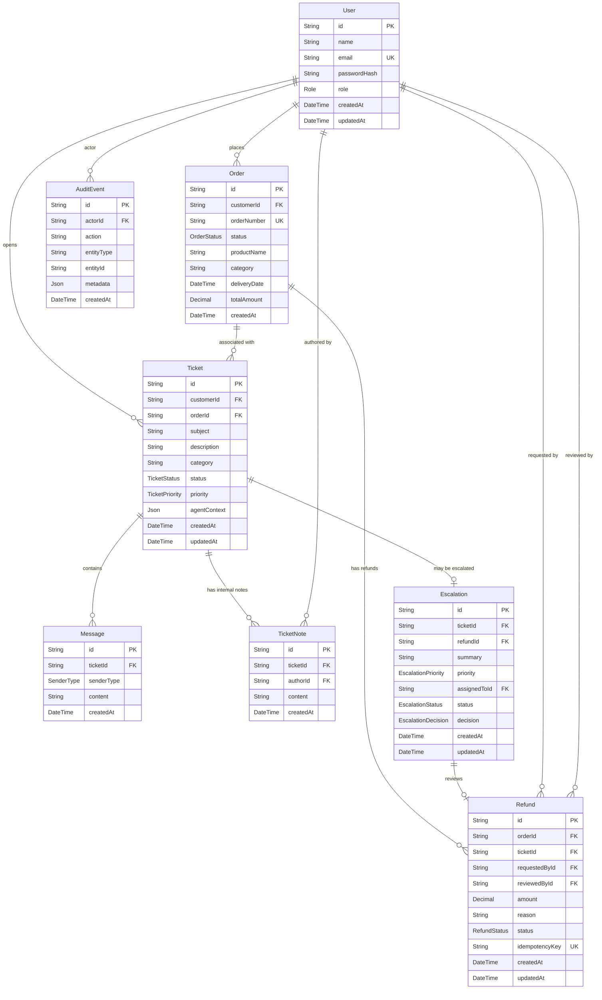

# DATABASE DESIGN
> Read before writing any Prisma schema or migration.
> Updated after schema changes.

---

## Entity Relationship Overview

```
User (1) ──────────< Order (many)
User (1) ──────────< Ticket (many)
Order (1) ──────────< Ticket (many, optional)
Ticket (1) ──────────< Message (many)
Ticket (1) ──────────< TicketNote (many, internal only)
Ticket (1) ──────────< Escalation (1, optional)
Order (1) ──────────< Refund (many, via ticket)
Escalation (1) ──────────< Refund (1, optional)
AuditEvent (append-only, references any entity)
```

---

## ER Diagram



---

## Entity Descriptions

### User
- Primary actor in the system. Role determines access level.
- `email` has a UNIQUE constraint.
- `passwordHash` is never returned through any API.
- Roles: `CUSTOMER`, `SUPPORT_AGENT`, `ADMIN`

### Order
- Represents a purchase made by a customer.
- `orderNumber` is unique and human-readable (e.g., `ORD-1001`).
- `deliveryDate` is used by the refund return window check.
- `totalAmount` is `Decimal` — never `Float`.
- `category` matches the return policy category list.
- Status: `PENDING`, `PROCESSING`, `SHIPPED`, `DELIVERED`, `CANCELLED`

### Ticket
- A support case opened by a customer.
- May or may not be linked to a specific order.
- `agentContext` is a JSON field storing structured state for the AI agent (e.g., `{ pendingIntent: 'REFUND', orderId: 'ORD-1001' }`).
- Status: `OPEN`, `IN_PROGRESS`, `WAITING_FOR_CUSTOMER`, `ESCALATED`, `RESOLVED`, `CLOSED`
- Priority: `LOW`, `MEDIUM`, `HIGH`, `URGENT`

### Message
- A chat message within a ticket conversation.
- Visible to both customers and staff.
- `senderType`: `CUSTOMER`, `AI`, `SUPPORT_AGENT`, `SYSTEM`
- **Never stores internal notes.** Notes go in `TicketNote`.

### TicketNote
- Internal note added by staff. **Never exposed to customers.**
- Stored in a separate table from `Message` to make the boundary explicit.

### Refund
- Represents a refund request and its processing lifecycle.
- Linked to both an `Order` and a `Ticket`.
- `idempotencyKey` has a UNIQUE constraint (database-level duplicate prevention).
- `amount` is `Decimal`.
- Status: `PENDING_REVIEW`, `APPROVED`, `REJECTED`, `PROCESSING`, `SUCCEEDED`, `FAILED`

### Escalation
- Created when a refund exceeds the auto-approval threshold or when the agent escalates.
- Linked to a `Ticket` (and optionally a `Refund`).
- Status: `OPEN`, `UNDER_REVIEW`, `RESOLVED`
- Decision: `PENDING`, `APPROVED`, `REJECTED`, `REQUEST_INFO`

### AuditEvent
- Append-only log of significant system events.
- Never mutated or deleted.
- `entityType` + `entityId` identifies the affected record.
- `metadata` is a JSON field for event-specific details.

---

## Indexes

```prisma
@@index([customerId])          // on Order, Ticket
@@index([ticketId])            // on Message, TicketNote, Escalation
@@index([orderId])             // on Refund
@@index([status])              // on Ticket, Refund, Escalation
@@index([createdAt])           // on AuditEvent
@@index([entityType, entityId]) // on AuditEvent
```

---

## Key Design Decisions

1. **Decimal for money** — `totalAmount`, `amount` are `Decimal` / PostgreSQL `NUMERIC`, not `Float`.
2. **Separate TicketNote table** — prevents accidental exposure of internal notes through customer-facing queries.
3. **agentContext JSON** — allows the AI agent to persist minimal structured state without additional tables.
4. **Append-only AuditEvent** — no UPDATE or DELETE on this table. Only INSERT.
5. **idempotencyKey UNIQUE** — database enforces refund deduplication even under concurrent requests.
6. **Cascading deletes** — `onDelete: Cascade` for messages/notes when a ticket is deleted. Refunds and escalations should NOT be deleted (audit trail).
